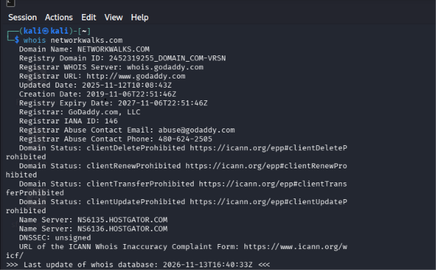
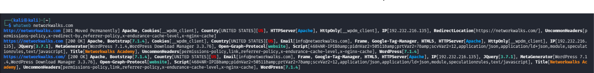
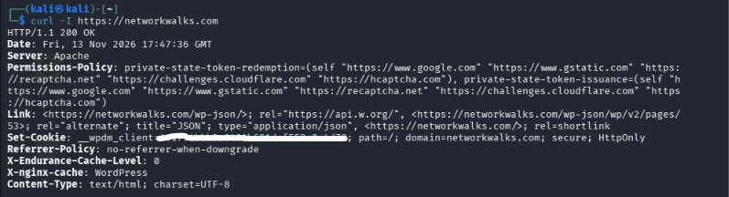
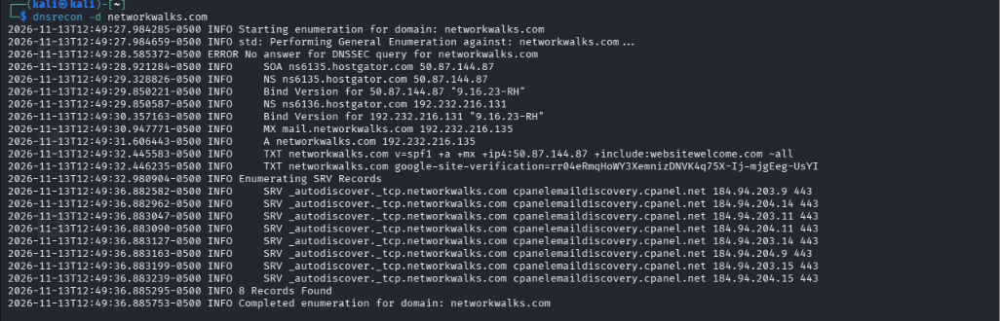
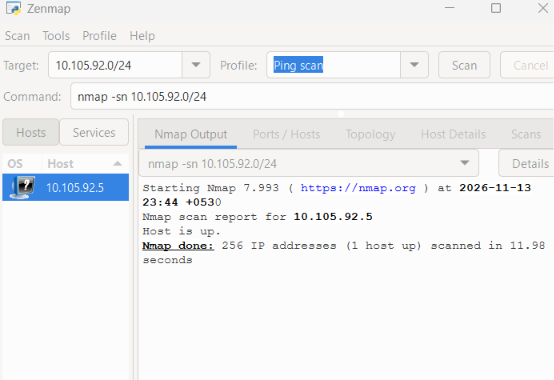

# NetworkWalks Cybersecurity Internship - Week 2

**Internship:** NetworkWalks Cybersecurity Internship  
**Batch:** B084  
**Modules Completed:** W2-PM1, W2-PM5 and W2-PM-FINAL

## 1. Project Overview

As part of Week 2 of my NetworkWalks Cybersecurity Internship, I performed footprinting and reconnaissance using Kali Linux tools and network discovery using Zenmap on Windows 11.

The activities focused on collecting publicly available domain information, identifying website technologies, examining DNS and HTTP information, detecting web application firewall technology, and discovering active devices on my own local network.

All activities were performed for educational purposes within the authorized scope. No exploitation was performed.

## 2. Tools Used

| Tool | Purpose |
|---|---|
| WHOIS | Retrieve domain registration information |
| WhatWeb | Identify website technologies |
| Nslookup | Resolve domain names to IP addresses |
| Curl | Examine HTTP response headers |
| Wafw00f | Identify Web Application Firewall technology |
| DNSRecon | Enumerate DNS records |
| Zenmap | Discover active hosts on a local network |

## 3. W2-PM1 - Footprinting and Reconnaissance

**Target:** `networkwalks.com` (instructor-specified domain)

### Task 1 - WHOIS

**Command:**
```bash
whois networkwalks.com
```

Used WHOIS to retrieve publicly available domain registration information.

**Observations:**
- Registrar: GoDaddy.com, LLC
- Creation date: 6 October 2019
- Expiry date: 11 October 2027
- Name servers: `ns6135.hostgator.com` and `ns6136.hostgator.com`



### Task 2 - WhatWeb

**Command:**
```bash
whatweb networkwalks.com
```

Used WhatWeb to identify technologies associated with the website.

**Observations:**
- Web server: Apache
- Content Management System: WordPress
- WP Download Manager plugin detected
- jQuery and Bootstrap detected
- Website IP address: `192.232.216.135`

The command initially took longer than expected to return results, but it eventually completed successfully.



### Task 3 - Nslookup

**Command:**
```bash
nslookup networkwalks.com
```

Used Nslookup to resolve the domain name to its IPv4 address.

**Observations:**
- DNS resolver: `8.8.8.8`
- Domain: `networkwalks.com`
- Resolved IP address: `192.232.216.135`
- Response type: Non-authoritative answer


### Task 4 - Curl

**Command:**
```bash
curl -I https://networkwalks.com
```

Used Curl to inspect the website's HTTP response headers.

**Observations:**
- HTTP response: `200 OK`
- Web server: Apache
- Content type: `text/html; charset=UTF-8`
- WordPress REST API reference: `/wp-json/`
- Cookie-related and caching headers were present

The cookie value was redacted from the screenshot before public documentation.



### Task 5 - Wafw00f

**Command:**
```bash
wafw00f networkwalks.com
```

Used Wafw00f to identify whether the website appeared to use a Web Application Firewall.

**Observations:**
- WAF identified: ModSecurity (SpiderLabs)
- Number of requests: 2

The result indicates that Wafw00f detected a fingerprint associated with ModSecurity.


### Task 6 - DNSRecon

**Command:**
```bash
dnsrecon -d networkwalks.com
```

Used DNSRecon to enumerate publicly available DNS information.

**Observations:**
- A records
- NS records
- MX records
- SOA records
- TXT records, including SPF information
- SRV records associated with email configuration

The results provided information about the domain's DNS and email-related infrastructure.



## 4. W2-PM5 - Network Scanning with Zenmap

### Objective

To identify active hosts on my own mobile hotspot network using Zenmap, the graphical interface for Nmap.

### Network Configuration

| Parameter | Result |
|---|---|
| Operating System | Windows 11 |
| Network | Personal mobile hotspot |
| Local IPv4 Address | `10.105.92.5` |
| Subnet Mask | `255.255.255.0` |
| Network Subnet | `10.105.92.0/24` |
| Default Gateway | `10.105.92.234` |
| Scan Type | Ping Scan |
| Hosts Discovered | 1 |

### Scan Procedure

1. Installed and opened Zenmap on Windows 11.
2. Identified the local IP address and subnet using `ipconfig`.
3. Entered `10.105.92.0/24` as the target network.
4. Selected the Ping Scan profile.
5. Executed the scan and reviewed the results.
6. Exported the network topology to PDF.

**Scan command:**
```bash
nmap -sn 10.105.92.0/24
```

### Scan Results

The scan examined 256 IP addresses and identified one responding host.

| Finding | Result |
|---|---|
| Hosts Up | 1 |
| Discovered Host | `10.105.92.5` |
| MAC Address | Redacted for privacy |
| Network Topology | Exported as PDF |

Only my laptop was discovered during the scan. No additional hosts were identified.



### Network Topology

The topology was exported from Zenmap and saved in PDF format.

[View Network Topology PDF](W2-PM5-Network-Topology.pdf)

## 5. Key Observations

- WHOIS provided publicly available domain registration and name server information.
- WhatWeb identified web technologies associated with the target website.
- Nslookup resolved the domain to its IPv4 address.
- Curl displayed HTTP response headers and website configuration details.
- Wafw00f identified a Web Application Firewall fingerprint.
- DNSRecon retrieved DNS and mail-related records.
- Zenmap discovered one responding host on my personal hotspot network.

These observations provide information about the target's publicly visible infrastructure and the local network. They do not establish the presence of security vulnerabilities.

## 6. Security Considerations

Based on the reconnaissance and network scanning activities, the following general security practices are relevant:

- Keep web servers, CMS platforms and plugins updated.
- Review publicly exposed technical information.
- Maintain appropriate HTTP security configurations.
- Review DNS records periodically.
- Properly configure and maintain Web Application Firewalls.
- Monitor authorized local networks for unfamiliar devices.
- Perform security testing only with appropriate authorization.

No vulnerability exploitation or validation was performed during these activities.

## 7. Key Learnings

This week's practical activities helped me understand:

- The role of footprinting and reconnaissance in cybersecurity.
- How different tools collect information about domains and websites.
- The importance of DNS records and HTTP response headers.
- Basic Web Application Firewall identification.
- Host discovery using Nmap and Zenmap.
- Documenting actual findings and distinguishing observations from confirmed vulnerabilities.

## 8. Final Report

The detailed Week 2 report contains the activities performed, recorded findings, screenshots, potential risks, security recommendations and conclusion.

- [Week 2 Final Report - PDF](NetworkWalks_Week2_Final_Report.pdf)
- [Week 2 Final Report - DOCX](NetworkWalks_Week2_Final_Report.docx)

## 9. References

- NetworkWalks Week 2 Project Module 1 - Footprinting with Multiple Kali Tools
- NetworkWalks Week 2 Project Module 5 - Network Scanning with Zenmap
- NetworkWalks Week 2 Final Report Sample
- [Kali Linux](https://www.kali.org/)
- [Nmap](https://nmap.org/)

---

*Documented as part of the NetworkWalks Cybersecurity Internship - Batch B084, Week 2.*
