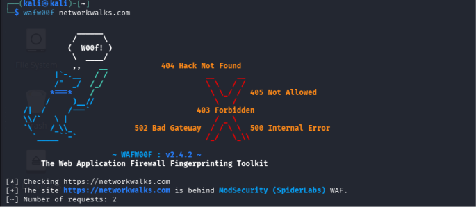

# NetworkWalks Cybersecurity Internship - Week 2

**Batch:** B084  
**Modules:** W2-PM1 (Footprinting using Kali Linux tools), W2-PM5 (Zenmap network discovery), W2-PM-FINAL (Report)

## Overview

Week 2 covered public-domain reconnaissance against the instructor-specified `networkwalks.com` target and ping-scan discovery on my personal mobile hotspot. The activities were limited to authorized educational exercises; no exploitation was performed.

## Tools and results

| Tool | Observation |
|---|---|
| WHOIS | Registrar GoDaddy; HostGator name servers |
| WhatWeb | Reported Apache, WordPress and other web technology fingerprints |
| Nslookup | Resolved `networkwalks.com` to `192.232.216.135` using 8.8.8.8 |
| Curl | HTTP 200; Apache; WordPress-related headers |
| Wafw00f | Reported ModSecurity (SpiderLabs) WAF |
| DNSRecon | A, NS, MX, SOA, TXT and SRV data |
| Zenmap | Ping scan on `10.105.92.0/24` reported 1 responding host (`10.105.92.5`) |

## Evidence

### WHOIS

### WhatWeb

### Nslookup
Recorded terminal result: `networkwalks.com` resolved to `192.232.216.135`. No separate screenshot was supplied.

### Curl

### Wafw00f

### DNSRecon

### Zenmap

## Final report and topology

- [Week 2 final report (PDF)](NetworkWalks_Week2_Final_Report.pdf)
- [Week 2 final report (DOCX)](NetworkWalks_Week2_Final_Report.docx)
- [Network topology (PDF)](W2-PM5-Network-Topology.pdf)

## Privacy and interpretation

The public portfolio copy intentionally omits the local device MAC address and redacts the HTTP cookie value. Reconnaissance data and technology fingerprints are not evidence of a confirmed vulnerability. Only one responsive device was observed in the hotspot ping scan; no other hosts are claimed.
